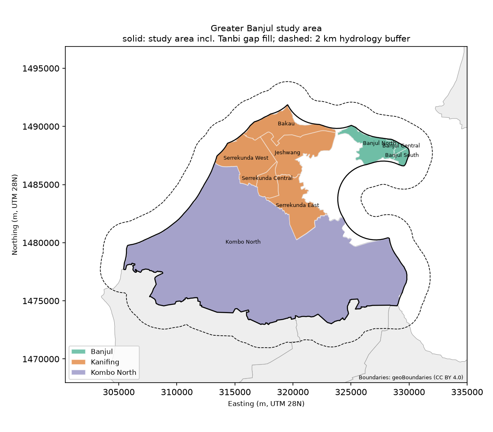
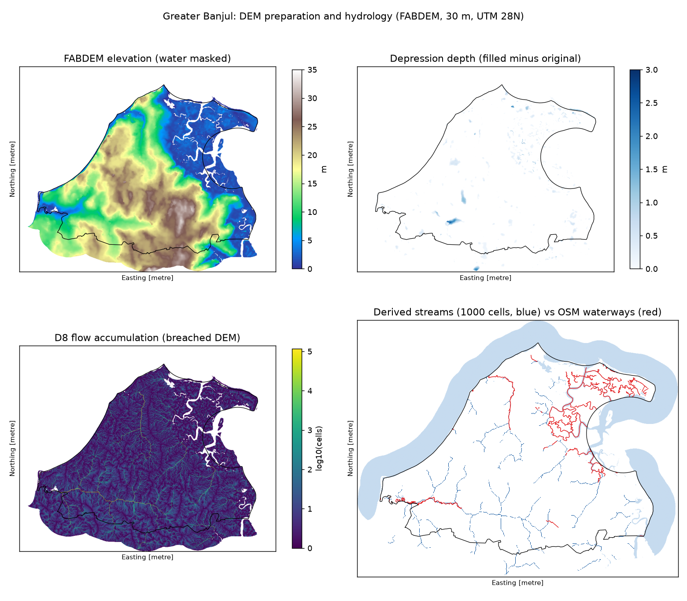
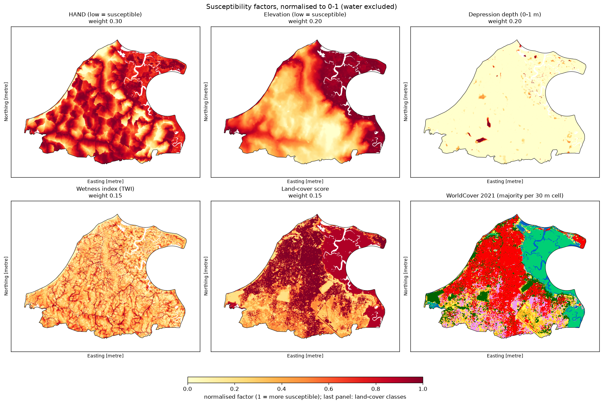
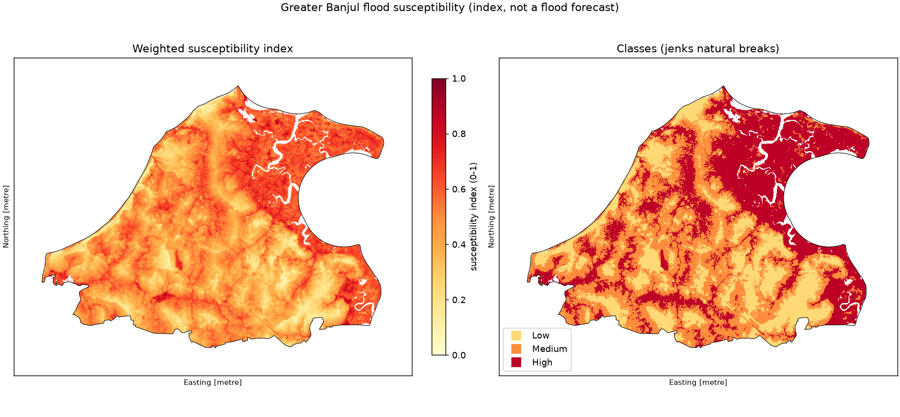
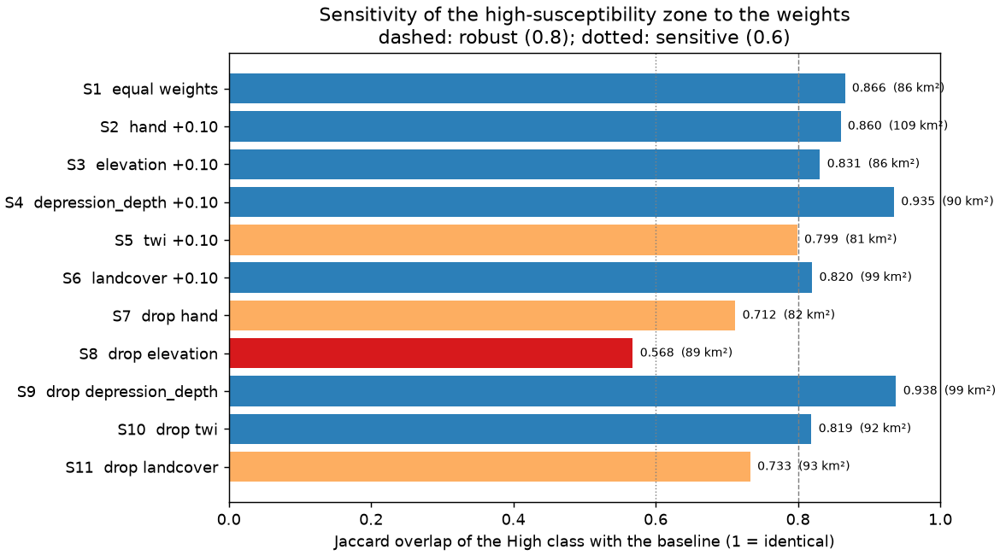
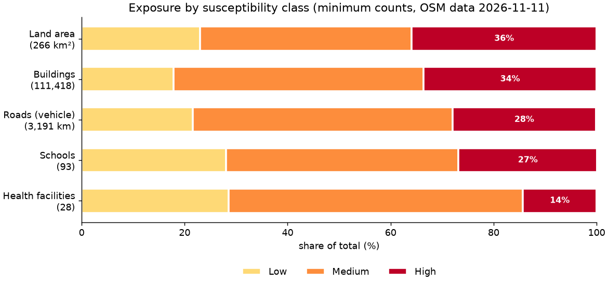
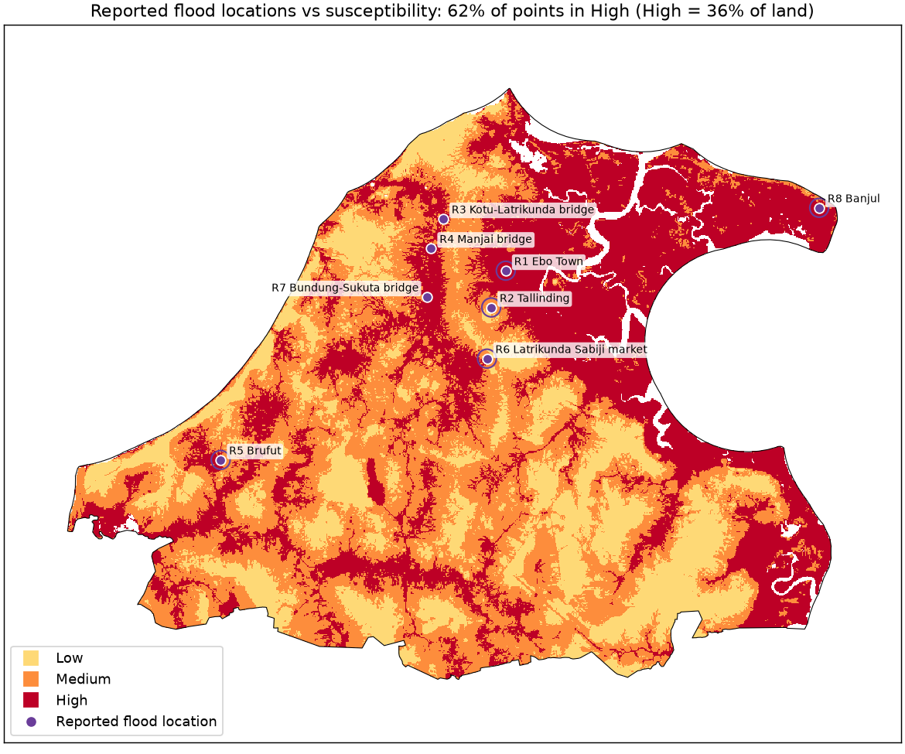

# Flood Susceptibility and Exposure Web Map for Greater Banjul

> **Work in progress** (personal project, November 2026). The full README follows on Day 10 of the work plan.

> **Disclaimer:** this project produces a *susceptibility index*, not a validated flood forecast. It is for illustration and learning, and must not be used for planning or safety decisions.

## Purpose

This repository identifies areas in Greater Banjul (The Gambia) that are most likely to flood, based on terrain and land cover. It then counts the buildings, roads, schools and health facilities in those areas. The results are published as an interactive web map. Everything is built from open data with a reproducible Python pipeline.

## Study area

Greater Banjul is defined as Banjul City Council, Kanifing Municipal Council and Kombo North district. The polygon is dissolved from geoBoundaries ADM2 units (CC BY 4.0). See `scripts/00_study_area.py`.

The ADM2 units leave out the Tanbi Wetland between Banjul and Kanifing. That wetland floods and carries the only road link to Banjul, so it is added back with a 3 km morphological closing (buffer out, then back in). Land belonging to other districts is subtracted afterwards. This adds 26.7 km², giving a study area of 273.4 km². Open water picked up this way is removed later by the water mask.



## Data sources

All sources were checked on 12 November 2026. Rasters are read remotely and clipped to the study area plus a 2 km buffer and a 0.05° margin. Exact URLs, dates and checksums are in [`data/raw/MANIFEST.csv`](data/raw/MANIFEST.csv).

| Data | Source | Resolution / date | Licence | Use |
|---|---|---|---|---|
| Elevation (primary) | FABDEM V1-2 (Hawker et al., 2022): Copernicus GLO-30 with buildings and forest removed | 1 arc-second (≈30 m) | CC BY-NC-SA 4.0 | Terrain factors |
| Elevation (comparison) | Copernicus DEM GLO-30, © DLR e.V. 2010-2014 and © Airbus Defence and Space GmbH 2014-2018, provided under COPERNICUS by the European Union and ESA | ≈30 m, surface model | Copernicus DEM licence | Sensitivity to DEM choice |
| Land cover | ESA WorldCover 2021 v200 (Zanaga et al., 2022) | 10 m, 2021 | CC BY 4.0 | Land-cover factor, water mask |
| Buildings, roads, facilities, water | © OpenStreetMap contributors, extract by Geofabrik | data as of 11 Nov 2026 | ODbL 1.0 | Exposure, drainage |
| Rainfall | CHIRPS v3.0, Climate Hazards Center, UCSB (Funk et al., 2026, *Sci Data* 13, 718) | 0.05° (≈5.5 km); monthly 1991-2025; daily Jun-Oct 2022 | Public domain (CC waiver); attribution requested | Rainfall context |
| Boundaries | geoBoundaries gbOpen GMB ADM2 | 2020 | CC BY 4.0 | Study area |
| Reported flood places | Gambian news reports (The Point, The Alkamba Times, Kerr Fatou, Voice Gambia), listed with quotes and URLs in [`config/reported_floods.csv`](config/reported_floods.csv) | 2022–2026 events | Cited, not copied | Plausibility check |

**Note on daily rainfall:** CHIRPS v3 daily values are not an independent daily product. They are 5-day (pentadal) totals spread across days using IMERG satellite timing (the `sat` variant). Daily peaks therefore show the timing only approximately; monthly totals are more reliable.

## Method notes

### DEM preparation and hydrology (`scripts/02_prepare_dem.py`)

- **Grid:** FABDEM is reprojected (bilinear) to a 30 m grid in WGS 84 / UTM zone 28N (EPSG:32628), covering the study area plus a 2 km buffer to avoid edge effects in flow routing.
- **Water mask:** FABDEM stores the sea as 0 m, so the DEM cannot separate water from land. Instead, a 30 m cell is water when at least 50% of its 10 m WorldCover cells are "permanent water bodies". Water cells are excluded from routing, so they act as outlets.
- **Breaching, not filling, for flow routing:** depressions are breached with a least-cost method (WhiteboxTools v2.4.0, maximum 100 cells), and only what cannot be breached is filled. Filling everything would erase the hollows where rain water ponds in flat, low-lying Banjul.
- **Depression depth:** the DEM is also filled separately, and *filled minus original* gives the depth of each hollow. It is kept as a susceptibility factor. Only 1.9% of land cells are more than 0.1 m deep (maximum 2.9 m), as expected for a smoothed bare-earth DEM.
- **Flow:** D8 flow direction and flow accumulation are computed on the breached DEM.
- **Stream threshold:** five thresholds were compared with OSM waterways. Agreement is the share of cells within 60 m of the other network ([table](outputs/tables/stream_threshold_tuning.csv)). The threshold of **1000 cells (0.9 km²)** was chosen: it gives 109 km of streams, close to the 114 km of mapped OSM waterways, with a better balance of agreement than lower thresholds.
- **Why agreement is low (F1 ≈ 0.16):** most OSM waterways are tidal creeks in the Tanbi Wetland and man-made urban drains. Neither can be derived from a 30 m DEM. The DEM-derived streams describe the upland valley network, which OSM mostly does not map. Where both exist, they coincide.
- **Drainage network:** derived streams, open water and OSM waterways (burned in) together form the drainage network used for HAND. This way, man-made drains and tidal creeks count as drainage.



### Susceptibility factors (`scripts/03_factors.py`)

Every factor is scaled to 0–1, with 1 meaning more susceptible. Open water is excluded and shown as its own map layer.

| Factor | How it is derived | Scaling | Weight |
|---|---|---|---|
| HAND (height above nearest drainage) | Height of each cell above the drainage cell it flows to (WhiteboxTools `ElevationAboveStream`) | Fixed 0–15 m, inverted. Classes after Nobre et al. (2011): below ≈5 m is flood-prone, above 15 m is upland | 0.30 |
| Elevation | FABDEM | 2nd–98th percentile (1.0–27.7 m), inverted | 0.20 |
| Depression depth | Filled minus original DEM | Fixed 0–1 m of ponding | 0.20 |
| Topographic wetness index (TWI) | ln(a / tan β), with D-infinity specific contributing area; minimum slope 0.1° | 2nd–98th percentile | 0.15 |
| Land cover | Runoff/wetness score per WorldCover class: built-up 1.0, wetland and mangrove 0.9, bare 0.7, cropland 0.5, grassland 0.4, shrubland 0.3, trees 0.2; averaged to 30 m | Already 0–1 | 0.15 |

- **No separate slope factor:** 88% of the land is flatter than 1° (median 0.4°), so slope hardly varies here. Slope still enters through TWI.
- **Fixed ranges** are used where a physical reference exists (HAND, ponding depth). They keep the scale the same when the DEM is swapped in the sensitivity test. Depression depth is zero for 98% of cells, so percentile scaling would rate any 5 cm hollow as maximum.
- **Overlap between factors is low.** The highest Spearman correlation is 0.32, between HAND and TWI, and HAND vs elevation is only 0.22 ([table](outputs/tables/factor_correlation.csv)). HAND measures height relative to the local drainage, which differs from absolute height in a landscape crossed by creeks and drains, so the factors are not double-counting one another.
- **Water and wetland:** 7.3 km² of open water and 47.0 km² of wetland and mangrove, mostly the Tanbi Wetland.



### Weighted overlay and classes (`scripts/04_overlay_classify.py`)

- **Index:** S = 0.30·HAND + 0.20·elevation + 0.20·depression depth + 0.15·TWI + 0.15·land cover. It is computed on the 295,611 land cells of the study area (266 km²) and ranges from 0.04 to 0.99 (median 0.48).
- **Why these weights:**
  - HAND gets the most weight because height above the nearest drainage is the most direct terrain indicator of where water collects.
  - Elevation and depression depth together cover coastal lowness and ponding, the dominant flood types in Banjul.
  - TWI and land cover adjust for flow convergence and for sealed surfaces.
- **Classes:** three classes from exact Jenks natural breaks (Fisher's algorithm) on **all** land cells. The index is first rounded to 0.001, so the algorithm runs on about 1000 distinct values weighted by their cell counts. A test confirms this gives the same breaks as `mapclassify.FisherJenks`. Jenks was chosen over quantiles because it places breaks at natural gaps in the data instead of forcing a third of the land into each class. The two methods agree on 87% of cells.

| Class | Index range | Area | Share of land |
|---|---|---|---|
| Low | < 0.365 | 61.1 km² | 23.0% |
| Medium | 0.365–0.536 | 109.4 km² | 41.1% |
| High | > 0.536 | 95.5 km² | 35.9% |

The High class includes most of the 47 km² of Tanbi wetland and mangrove, which is wet by nature. The exposure analysis shows where High overlaps with buildings and services.



### Sensitivity of the weights (`scripts/05_sensitivity.py`)

The model was re-run, with index and classes, for 11 alternative weightings: equal weights; each factor +0.10 (others reduced proportionally); and each factor dropped. The High class of each run is compared with the baseline using the Jaccard overlap (shared cells ÷ cells in either). Full results: [sensitivity.csv](outputs/tables/sensitivity.csv).

- **Robust to moderate changes:** every "+0.10" scenario and equal weights keep 0.80–0.94 overlap, and the High area stays between 81 and 109 km².
- **Elevation matters most:** dropping it gives the lowest overlap (0.57). Dropping HAND (0.71) or land cover (0.73) has a moderate effect.
- **Depression depth has little influence** despite its 0.20 weight: dropping it leaves 0.94 overlap. It is zero on 98% of cells, so it acts as a local flag for distinct hollows rather than shaping the overall pattern.



**Effect on exposure:** the share of buildings in the High class varies more than the High area does: 23% to 43% across scenarios (baseline 34%). Most buildings stand on low, gently sloping land near the class boundary, so changing the elevation or land-cover weight moves many of them between Medium and High. Exposure counts should therefore be read as an order of magnitude, not exact figures.

### Exposure (`scripts/06_exposure.py`)

OSM buildings, roads, schools and health facilities inside the study area were assigned to the class of the 30 m cell they lie in. Buildings and facilities are counted by a point inside each footprint. Roads are clipped by the class polygons and measured in km. "Vehicle roads" leave out footpaths, paths, steps and tracks. Health facilities are hospitals, clinics, doctors and other `healthcare=*` features, but not pharmacies. A facility mapped both as a point and as a polygon with the same name within 50 m is counted once. Full table: [exposure.csv](outputs/tables/exposure.csv).

| Asset (OSM, 11 Nov 2026) | In High | Share in High | Total |
|---|---|---|---|
| *Land area (reference)* | *95.5 km²* | *36%* | *266 km²* |
| Buildings | 37,439 | 34% | 111,418 |
| Vehicle roads | 890 km | 28% | 3,191 km |
| Schools | 25 | 27% | 93 |
| Health facilities | 4 | 14% | 28 |

- **Banjul is almost entirely exposed:** 97% of its buildings are in the High class, compared with 37% in Kanifing and 29% in Kombo North ([by council](outputs/tables/exposure_by_council.csv)).
- **Buildings and services are slightly less exposed than the land as a whole.** Most settlements sit on the higher ground between valleys, and the High class also covers undeveloped wetland. Schools and health facilities, which are often on planned sites, show this most clearly.
- **These are minimum counts.** OSM coverage is incomplete, especially for facilities, and building footprints are traced from imagery of different dates.



### Plausibility check (`scripts/08_plausibility.py`)

There is no flood map to validate against, so the map was compared with places that news reports name as flooded. Eight places in the study area could be identified and located from Gambian news reports of the July 2022 floods (276 mm at Banjul airport on 30–31 July), a June 2025 flood and the August 2026 Banjul flood. Each place is located with an OSM feature in the local extract (a settlement point, a ward or a bridge). The quotes and source URLs are in [`config/reported_floods.csv`](config/reported_floods.csv).

| Measure | Value |
|---|---|
| Reported places in High | 5 of 8 (62%), while High covers 36% of land |
| Reported places in High or Medium | 8 of 8, while High + Medium cover 77% of land |
| Mean share of High within 100–300 m of each place | 66% |

**Where the map agrees:** Ebo Town, Brufut and the three bridges over Kotu Creek (Kotu–Latrikunda, Manjai, Bundung–Sukuta) are all High. The creek valley is the clearest flood corridor in the model.

**Where it does not:**
- **Banjul** (Medium at the city point, but 83% High within 300 m). The OSM point for the city sits on a slightly higher street. The surrounding city is High.
- **Tallinding** and the **Latrikunda Sabiji market** (Medium, little High nearby). The reports blame blocked drains and houses built on waterways. Blocked drains are not visible in a 30 m terrain model. The DEM also smooths the small channels that run through these dense neighbourhoods.

With only 8 points, this is a check that the map is plausible, not a validation. Settlement points are approximate, and news coverage favours places that are easy for reporters to reach.



## Reproduce

```bash
# 1. Install micromamba (https://mamba.readthedocs.io), then:
micromamba env create -f environment.yml
micromamba activate flood-banjul

# 2. Run the pipeline and the tests
make all
make test
```

Raw data is downloaded by the scripts and is not stored in Git. Every downloaded file is listed with its URL, date, licence and checksum in [`data/raw/MANIFEST.csv`](data/raw/MANIFEST.csv).

Preview the map locally with `make serve`, then open http://localhost:8000.

## Licence

Code: MIT (see [LICENSE](LICENSE)). Data: each source keeps its own licence (see `data/raw/MANIFEST.csv`). Map data © OpenStreetMap contributors (ODbL).
